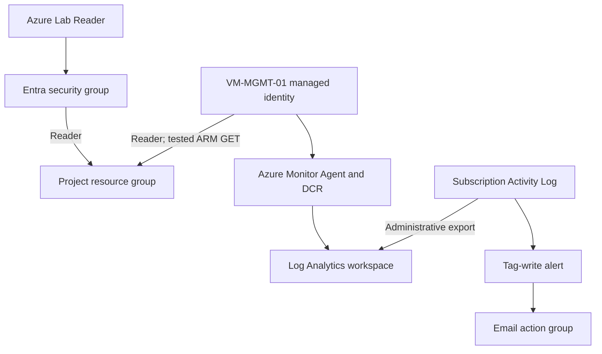

# Azure Project 3: Identity, Access and Monitoring

**Author: Samuel Gebu | Lab dates: 11–12 October 2026**

Built and tested group-based Azure access, administrative auditing, a managed identity, and guest VM monitoring. This is a personal lab, not a production implementation.

## Business scenario

A fictional company needs auditors to inspect cloud resources without changing them, administrators to investigate changes, and a server to authenticate without embedded credentials.

## Environment

| Component | Configuration |
|---|---|
| Project resource group | `rg-identity-monitoring-lab`, South Africa North |
| Security group | `sg-azure-lab-readers`, Security / Assigned |
| Test user | Azure Lab Reader |
| User access | Reader assigned to the group at project resource-group scope |
| Workspace | `law-identity-monitoring-lab`, pay-as-you-go |
| Log export | `diag-activity-to-law`, subscription Administrative category |
| Activity alert | `alert-lab-tag-changes`, Write tags operation |
| Email action group | `ag-lab-email`, display name LabEmail |
| Reused VM | `VM-MGMT-01` in `RG-CORP-NETWORK-LAB` |
| VM identity | System assigned; Reader on the project resource group |
| VM monitoring | Azure Monitor Agent, classic log-based metrics, existing workspace |
| DCR | `msvmi-southafricanorth-vm-mgmt-01` proposed during onboarding |

The VM remains in the earlier network lab's resource group. Do not assume all components are contained in the Project 3 group.

## Architecture

The managed identity path and telemetry path are separate. Reader permits management-plane reads; it does not automatically grant access to secrets or application data. Activity Log alerts evaluate Activity Log events directly, rather than the workspace KQL query.

## Validation

| Test | Result | Evidence |
|---|---|---|
| Test user views project group | Passed | Lab-user resource-group view |
| Test user changes tags | Passed: denied | `AuthorizationFailed` screenshot |
| Administrative logs exported | Passed | AzureActivity tag-write Start / Success records |
| KQL success filter | Passed | Successful tag-write row with caller |
| Activity Log alert | Passed | Fired alert at 23:09 UTC on 11 October |
| Email receiver enrollment | Passed | LabEmail enrollment confirmation |
| Actual alert email delivery | **Not verified** | Enrollment message is not an alert email |
| Managed identity reads project group | Passed | PowerShell returned group name and `southafricanorth` |
| Agent heartbeat | Passed | Windows heartbeat at 01:13 UTC on 12 October |
| Guest performance ingestion | Passed | InsightsMetrics disk free-space, throughput and latency samples |
| Cleanup | **Pending** | No deletion or deallocation evidence supplied |

The alert review showed the Write tags signal but did not show a success-status filter. Its final status filtering is therefore not claimed as verified. Two alert instances appeared in the list; only the project resource-group instance was inspected.

## Troubleshooting demonstrated

1. RDP failed because the administrator's current public IP differed from the `/32` source allowed by the subnet NSG. Updating `Allow-RDP-My-PC` restored the connection while keeping access restricted to one IP.
2. A multiline PowerShell paste broke the token request. Running each command on one line fixed the syntax; the VM then successfully called Azure Resource Manager using its own identity.
3. Email receiver verification was required. Enrollment was confirmed, but end-to-end alert email receipt still needs evidence.

## Files

- `queries/`: reproducible KQL queries.
- `scripts/test-managed-identity.ps1`: read-only identity test with a subscription-ID parameter.
- `docs/portfolio-report.md`: detailed implementation and limitations.
- `docs/cleanup.md`: cleanup instructions, including reused-resource safeguards.
- `docs/evidence-index.md`: screenshot references from this lab.

## Suggested GitHub repository

Name: `azure-identity-access-monitoring-lab`

Description: Hands-on Azure lab demonstrating Entra group-based RBAC, managed identity authentication, Activity Log auditing, alerts and VM monitoring with KQL.

Upload this folder's contents to the repository root. Add reviewed screenshots under `screenshots/`; remove personal email addresses, tenant/subscription identifiers, live public IPs and unrelated browser content before public sharing. Never publish passwords, access tokens or verification codes.

## Portfolio statement

Implemented resource-group-scoped Reader access through a Microsoft Entra security group and verified allowed reads and denied tag writes with a separate account. Configured Administrative Activity Log export, investigated events with KQL, triggered an Activity Log alert, tested a VM managed identity against Azure Resource Manager, and verified guest heartbeat and performance ingestion into Log Analytics.
